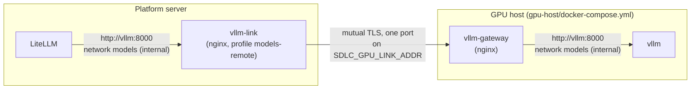

# ADR-M71. A self-hosted model service (vLLM) on the platform server's GPU or a separate GPU host

| Item | Value |
|---|---|
| Status | **Accepted** (Harry, 2026-10-24, L01 plan: QUESTIONS #546–#550). Version 1.1: §4, a separate GPU host (Harry, 2026-11-11, L01 PR 2 plan: QUESTIONS #666–#669) |
| Date | 2026-10-24 |
| Decided by | Harry (L01 plan approved on 2026-10-24; the separate GPU host split off to L01 PR 2, QUESTIONS #546) |
| Related | D-08 L01 AC1–AC4, L03; ADR-M91 §2.3 (a link between two machines), ADR-M63 and ADR-M67 §2.7 (certificates); D-02 NFR-01; D-03 §10, §10.1; D-07 §3, §4, §9; ADR-M10 §3 (models), ADR-M17 (Compose), ADR-M24 (LiteLLM keys from OpenBao), ADR-M78 (evaluation harness, L02); design/QUESTIONS.md #362, #424, #546–#550, #666–#669 |

## 1. Context

Many clients classify their data as `client_restricted`: it must never leave the company (D-07 §4). The routing rule already exists: a `client_restricted` intent may use `self_hosted` models only (`allowedModels`, the mandatory rule `routing_restricted_self_hosted`). So far the only self-hosted model is Ollama on a developer machine, which is never allowed for client data. A self-hosted model service on company hardware is a condition to sell (QUESTIONS #362).

L02 measured local models on a laptop (D-07 §9): a 20B model resolves about two of three small tasks; a model of about 30B or more did not fit. The company has no GPU yet. This ADR records how the platform runs vLLM (Apache-2.0) when a GPU exists, so that L03 and a rented GPU can measure larger models with the same stack.

## 2. Decision

### 2.1. The Compose profile `models-local` (QUESTIONS #546, #549)

- A service `vllm` in a new, **optional** profile `models-local`, off by default (R041). Image `vllm/vllm-openai:v0.31.0`, pinned by tag and digest (R038). Start: `pnpm compose:models-local` (profiles `core`, `models` and `models-local`).
- **The GPU is in the platform server** (L01 PR 1), or in a separate GPU host (L01 PR 2, §4).
- The GPU is reserved through `deploy.resources.reservations.devices` (driver `nvidia`, `SDLC_VLLM_GPU_COUNT`, default 1). The same count is vLLM's `--tensor-parallel-size`.
- **Network.** `vllm` is only on a new **internal** network `models` (`<project>-models`; no route to the internet). LiteLLM joins `models` always, so LiteLLM's networks do not depend on the profile (as the api joins `access`, ADR-M67 §2.6). Nothing else is on `models`. `vllm` has **no host port**. So only LiteLLM can call it, and vLLM's own API needs no key (QUESTIONS #546: vLLM's `--api-key` does not cover every route, so the network is the boundary).
- **Health check.** `GET /health` on 127.0.0.1:8000 inside the container, with a start period of 15 minutes (loading the weights takes time).
- **Concurrency limit** (AC1, QUESTIONS #549): two layers with the same value `SDLC_VLLM_MAX_NUM_SEQS` (default 4).
  - vLLM `--max-num-seqs`: the most requests in one batch on the GPU.
  - LiteLLM `max_parallel_requests` on the deployment: LiteLLM refuses a request beyond the limit at once, instead of queueing it at vLLM until the agent's timeout.
- **Other settings** from `.env`, each with a default: `SDLC_VLLM_MAX_MODEL_LEN` (32768, the context length the agents use), `SDLC_VLLM_GPU_MEMORY_UTILIZATION` (0.90), `SDLC_VLLM_TOOL_PARSER` (`qwen3_coder`; tool calls are needed by the coding agents), `SDLC_VLLM_SHM_SIZE` (8gb).
- **Hardening.** All capabilities dropped, `no-new-privileges`. vLLM does not log prompts by default (`--enable-log-requests` is off); the platform never turns it on (R031). Usage statistics are off (`VLLM_NO_USAGE_STATS=1`, `DO_NOT_TRACK=1`).

### 2.2. The model and its weights (QUESTIONS #547)

- The model is a setting, not code: `SDLC_VLLM_MODEL` (a Hugging Face repository) and `SDLC_VLLM_MODEL_REVISION` (a commit hash is recommended; default `main`). The default is `Qwen/Qwen3-Coder-30B-A3B-Instruct` (Apache-2.0): a 30B-class model, the size L02 could not measure. L03 decides which model the company uses.
- `SDLC_VLLM_SERVED_NAME` is the name LiteLLM and the agent register see (`model_ref`). It must carry the model's version (QUESTIONS #93), for example `qwen3-coder-30b-a3b-instruct-2507`.
- **Weights are downloaded once, by an operator**, into the volume `vllm-models`: `pnpm models-local:pull` runs the one-shot service `vllm-pull` (same image, profile `models-local-pull`, on the `sdlc` network, which has internet access). Only public models: no Hugging Face token is stored.
- `vllm` mounts `vllm-models` **read-only** and runs with `HF_HUB_OFFLINE=1`: it never downloads anything, and it cannot change the weights.

### 2.3. The LiteLLM entry (AC2, QUESTIONS #548)

- The provider entry `kv/litellm/providers/vllm` in OpenBao, written by the operator (runbook T11 §5d.1), with two fields that are not secrets: `api_base` (`http://vllm:8000/v1`) and `model` (= `SDLC_VLLM_SERVED_NAME`). The model appears in LiteLLM only when this entry exists, as for every provider (ADR-M24).
- The entry in `litellm/config.ctmpl`: `model_name` = the field `model`, `litellm_params.model` = `hosted_vllm/<model>`, `max_parallel_requests` from the sidecar's `SDLC_VLLM_MAX_NUM_SEQS` (the template fails if it is not a number), and `model_info.provider_type: self_hosted`.
- **Internal cost per token above 0**, so budgets keep working (D-07 §3): USD 0.0000001 per input token and USD 0.0000004 per output token, the same [Proposal] placeholder as the Ollama entry, until L03 gives the GPU cost per token. A static test checks that both are above 0.
- Every call still goes through LiteLLM with the run's virtual key and its seven labels (R027). The routing does not change: G4 gives a `client_restricted` intent only `self_hosted` models (D-07 §4).

### 2.4. Tests (AC4, QUESTIONS #550)

- Static (`pnpm test`): the profile, the pinned image, the GPU reservation, the internal network, no port, the health check, the limits, offline mode and the read-only weights; the template entry (self-hosted, cost above 0, the limit), and the test template equal to it.
- Live, no GPU (`pnpm test:litellm`): the test template has the same `vllm` entry; the provider entry points at the existing stub model, which speaks the same OpenAI-style API as vLLM. The test checks that LiteLLM lists the model as `self_hosted`, that a `client_restricted` intent routes only to it, that a run key with the seven labels calls it, and that the spend is recorded with `provider_type` `self_hosted` and a cost above 0, and that the key's budget stops it.
- Real model, owner only (`pnpm test:agent-api` with `SDLC_AGENT_API_MODEL` and `SDLC_AGENT_API_DATA_CLASS`): the real agent run end to end with the vLLM model (on a GPU) or the Ollama model on a developer machine, for a `client_restricted` intent.
- vLLM itself is not run in CI (no GPU).

## 3. Consequences

- D-03 §10.1 no longer says "API models only, no GPU": the GPU is optional, the profile is off by default, and the server without a GPU runs as before.
- The `.env` of an existing stack needs nothing: every new setting has a default. LiteLLM joins the new network `models` at the next `up`.
- The GPU host needs the NVIDIA driver and the NVIDIA Container Toolkit (deploy README "Self-hosted model").
- The internal cost is a placeholder until L03. The [GPU sizing note](L03-gpu-sizing-note.md) §7 estimates that the real cost per token is probably several times higher at low use; it needs a measurement on a GPU before the template changes.

## 4. A separate GPU host (L01 PR 2, version 1.1; QUESTIONS #546, #666–#669)

vLLM's `--api-key` does not protect every route (vLLM documents that `/invocations` stays open), and LiteLLM v1.104.0 cannot present a client certificate. So the two machines use **mutual TLS** (both sides show a certificate of the same CA), ended by nginx on both sides. vLLM never speaks TLS itself and never listens on a host port.

### 4.1. The GPU host (QUESTIONS #666, #667)

- Its own Compose file `platform/deploy/gpu-host/docker-compose.yml`, started with `pnpm gpu-host:up`: `vllm` and `vllm-pull` with the **same definitions** as in `docker-compose.yml` (only the networks and profiles differ; a static test compares them), the job `vllm-gateway-tls-init` and the service `vllm-gateway`. No platform service, volume or network. The script refuses an Engine that holds the platform's data (as the runner host does, ADR-M91 §2.1).
- `vllm` stays only on the internal network `models` of the GPU host, with no port: everything of §2.1 and §2.2 still holds (R137).
- `vllm-gateway`: the pinned nginx image of the profile `access`. It joins `models` and a second network `link` (needed to publish a port). It publishes **one port**, `SDLC_GPU_LINK_PORT` (default 8443), **only on `SDLC_GPU_LINK_ADDR`** (the GPU host's address that the platform server reaches; never `0.0.0.0` by default, the variable is required). The infrastructure operator also allows that port only from the platform server in the firewall.
- The gateway requires a client certificate signed by the link's CA (`ssl_verify_client on`) **and** a subject that names the link (`CN` = `SDLC_GPU_LINK_CLIENT_CN`, default `sdlc-vllm-link`): with a company CA, other company certificates are refused (403).
- It forwards only `POST /v1/chat/completions`, `POST /v1/completions`, `GET /v1/models` and `GET /health`; everything else answers 404, so `/invocations`, `/metrics` and the other vLLM routes are never reachable from the link.
- It logs the time, the client address, the method, the path without the query string, the status and the duration: never a header or a body (R031). No response buffering (streamed answers), a long read timeout (`SDLC_GPU_LINK_READ_TIMEOUT`, default 600 s) and a body limit of 16 MiB (long prompts).

### 4.2. The platform server: the profile `models-remote` (QUESTIONS #667)

- The optional profile `models-remote` runs `vllm-link` (the same pinned nginx image) and its job `vllm-link-tls-init`. Start: `pnpm compose:models-remote` (profiles `core`, `models`, `models-remote`).
- `vllm-link` joins `models` with the **alias `vllm`** and listens on 8000 without TLS there, so the LiteLLM entry (`api_base` `http://vllm:8000/v1`, §2.3) and the provider entry in OpenBao do not change. It also joins its own network `models-link` (`<project>-models-link`), which only it joins and which has a route out; `models` stays internal. It has no host port.
- It calls `https://<SDLC_GPU_HOST_NAME>:<SDLC_GPU_LINK_PORT>` with the client certificate, verifies the GPU host's certificate against the link's CA and its name (`proxy_ssl_verify on`, `proxy_ssl_name`), and forwards the same four routes only. `SDLC_GPU_HOST_ADDR` is the address of that name (an `extra_hosts` entry), so no DNS is needed.
- `up.sh` refuses `models-local` and `models-remote` in the same call (two services with the name `vllm` on `models`), and refuses `models-remote` without `SDLC_GPU_HOST_NAME`, `SDLC_GPU_HOST_ADDR` and `SDLC_VLLM_LINK_TLS_DIR`. A certificate that ends within 30 days only warns.
- The concurrency limit (§2.1) is unchanged: `SDLC_VLLM_MAX_NUM_SEQS` on the platform (LiteLLM) and on the GPU host (vLLM) must be equal; the deploy README says so.

### 4.3. Certificates (QUESTIONS #668)

- `platform/deploy/gpu-link/tls.sh` (`pnpm gpu-link:tls …`), like `access/tls.sh`: `dev <host name> <folder>` (a throw-away CA whose key is deleted at once, test machines only), `issue <ca-folder> <host name> <folder>` (with the internal CA of `openbao/tls.sh ca`, 1 year), `check <folder> [host name]` (chain, key, purpose, name, 30 days before the end), `reload platform|gpu-host`.
- Two sets: `<folder>/platform/` (`ca.pem`, `client.pem`, `client-key.pem`; `extendedKeyUsage=clientAuth`, `CN=sdlc-vllm-link`) for `SDLC_VLLM_LINK_TLS_DIR`, and `<folder>/gpu-host/` (`ca.pem`, `server.pem`, `server-key.pem`; `serverAuth`, the GPU host's name) for `SDLC_GPU_LINK_TLS_DIR`. Keys have mode 600; a CA key is never in either folder. Certificates of the company CA (A10 PR 3) are put in the same folders and checked with `check`.
- Renewal: issue again, then `reload` on each side (the job copies the files, nginx reads them again on SIGHUP; no restart). Runbook T11 §5d.2.

### 4.4. Tests (QUESTIONS #669)

- Static (`pnpm test`): the GPU host's Compose file (no platform service; `vllm` and `vllm-pull` equal to the platform's; one port on `SDLC_GPU_LINK_ADDR`), the two nginx templates (client certificate and name required, verification on, four routes, no header in the log), the profile `models-remote`, `up.sh`'s refusals, and `tls.sh`.
- Live (`pnpm test:vllm-link`, Docker, in CI): the GPU host's project with the stub model in place of vLLM, the platform's `vllm-link`, certificates of `tls.sh issue` with a throw-away CA. A call through the link reaches the stub; a client without a certificate, with one of another CA or with another name is refused; the link refuses a GPU host whose certificate comes from another CA or names another host; `/invocations` and `/metrics` answer 404.
- The owner's real run on a GPU stays as in §2.4.

## 5. Alternatives not chosen

- **Ollama on the server**: made for one user on a desktop; no batching of many requests; vLLM is the serving engine D-07 §3 chose.
- **vLLM downloads the weights at start** (QUESTIONS #547 b): it would need internet access every time it runs next to client data.
- **The internal cost in OpenBao fields** (QUESTIONS #548 b): a cost is not a secret, and a fixed value in the template is checked by a test.
- **Only the vLLM limit** (QUESTIONS #549 b): requests over the limit would wait at vLLM until the agent's own timeout.
- **vLLM's own TLS on the GPU host** (`--ssl-cert-reqs 2`, the first idea of §4; QUESTIONS #666 b): vLLM would need a host port and a network with a route out, and every vLLM route, `/invocations` too, would be open to any holder of a client certificate of the CA.
- **A WireGuard tunnel, as for the runner host** (QUESTIONS #667 b): mutual TLS already authenticates both machines and encrypts the link; the tunnel would add a second system for the operator to run, and could still be added below the link later.

## Version history

| Version | Date | Author | Notes |
|---|---|---|---|
| 1.0 | 2026-10-24 | Claude (task L01 PR 1), accepted by Harry in the L01 plan | First version (QUESTIONS #546–#550) |
| 1.1 | 2026-11-11 | Claude (task L01 PR 2), accepted by Harry in the L01 PR 2 plan | §4: a separate GPU host with mutual TLS ended by nginx on both sides (the gateway instead of vLLM's own TLS), the profile `models-remote`, `gpu-link/tls.sh`, the tests (QUESTIONS #666–#669) |
